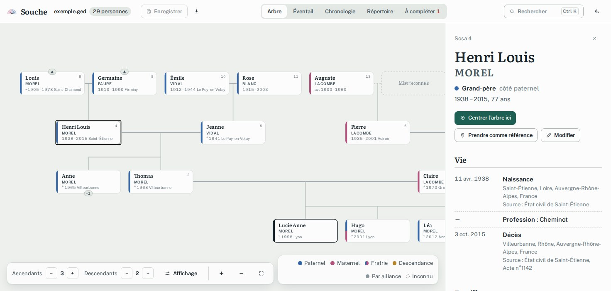
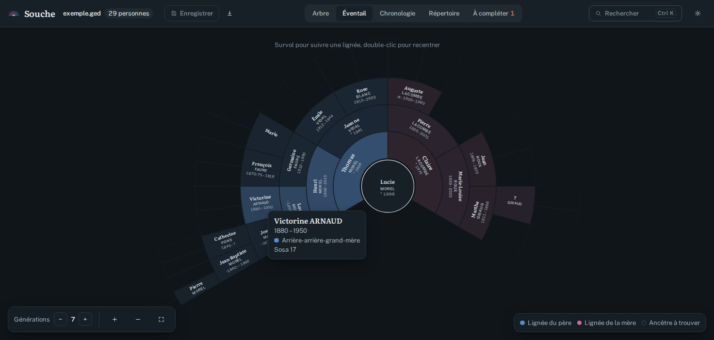

# Souche

Une visionneuse d’arbre généalogique moderne pour les fichiers **GEDCOM** (`.ged`).
Le fichier est lu dans le navigateur : rien n’est envoyé sur un serveur.

**Essayer en ligne : [souche.kiki-kalagan.workers.dev](https://souche.kiki-kalagan.workers.dev/)**, puis ouvrir un fichier `.ged` ou cliquer sur « Voir un exemple ».





*Captures réalisées avec la famille fictive fournie en exemple.*

## Ce que ça affiche

- **Arbre** : ascendants au-dessus, descendants en dessous, conjoints et fratrie (demi-frères et demi-sœurs compris) autour de la personne centrale. Double-clic pour recentrer, avec une transition animée. Les parents manquants apparaissent en pointillés, pour qu’on voie où chercher.
- **Éventail** : les ancêtres en anneaux, numérotés Sosa. Le survol d’une case suit la lignée jusqu’au centre. Les cases vides marquent les ancêtres encore inconnus.
- **Chronologie** : chaque vie sur une frise, avec les mariages et les grandes périodes historiques. Les dates approximatives (« vers », « avant ») s’estompent au lieu d’être affichées comme certaines.
- **Répertoire** : toutes les personnes, triables et filtrables par nom, lieu, métier ou lien de parenté.
- **À compléter** : les ancêtres directs sans parents connus (les « pistes de recherche »), les incohérences de dates (enfant né après le décès du père, parent trop jeune…), les notes marquées « à confirmer » et le taux de complétude.
- **Fiche personne** : événements avec lieux et sources, parents, unions, enfants, fratrie, notes (avec liens cliquables).

## Modifier ou créer un arbre

- **Créer un arbre** depuis l’accueil : on part d’une première personne, puis on ajoute père, mère, conjoints, enfants, frères et sœurs depuis sa fiche.
- **Modifier** une fiche : prénoms, nom, sexe, naissance, décès, mariages et notes. Les dates s’écrivent en français (`17/06/1998`, `vers 1900`, `avant 1950`, `entre 1870 et 1875`), les lieux déjà présents sont proposés pendant la saisie.
- **Enregistrer** : dans Chrome et Edge, le fichier ouvert est réécrit directement (ou un emplacement est demandé pour un nouvel arbre) ; ailleurs, le `.ged` est téléchargé. Le bouton de téléchargement donne une copie à tout moment.

Souche ne modifie que ce qu’on change : les autres données du fichier (sources, médias, balises propres à un logiciel) sont conservées telles quelles.

Les couleurs suivent la lignée : bleu pour le côté paternel, framboise pour le côté maternel, ocre pour la descendance, gris pour les alliances. Le lien de parenté est calculé en français (« cousine issue de germain », « oncle à la mode de Bretagne », « belle-mère »…) depuis une personne de référence, modifiable dans la fiche.

## Utilisation

```sh
pnpm install
pnpm dev
```

Ouvrez ensuite l’adresse affichée et chargez un fichier `.ged`, ou cliquez sur « Voir un exemple ».

### Suivre le fichier pendant qu’on l’écrit

Pour voir l’arbre se mettre à jour à chaque enregistrement du `.ged`, deux options :

1. **Mode développement** (tous navigateurs) : créez un fichier `.env.local` à côté de `package.json`.

   ```sh
   SOUCHE_FILE=C:/chemin/vers/arbre.ged
   ```

   `pnpm dev` charge alors ce fichier directement et le relit dès qu’il change, y compris sur un lecteur réseau.

2. **Dans le navigateur** : avec Chrome ou Edge, « Ouvrir un fichier .ged » garde un accès au fichier et le relit à chaque modification. Sous Brave, activez d’abord `brave://flags/#file-system-access-api`. Ailleurs, le fichier est lu une seule fois.

### Version statique

```sh
pnpm build
```

Le dossier `dist/` peut être hébergé n’importe où (un NAS, n’importe quel hébergeur statique) : tout se passe dans le navigateur.

`wrangler.jsonc` décrit un Worker Cloudflare qui sert ce dossier tel quel (fichiers statiques uniquement) : build `pnpm build`, déploiement `npx wrangler deploy`.

## Confidentialité

L’arbre n’est jamais envoyé ni stocké en ligne. Le navigateur ne mémorise que des préférences (thème, profondeur de l’arbre, personne de référence) et, sous Chrome ou Edge, le lien vers le dernier fichier ouvert.

Le `.gitignore` exclut tous les fichiers `.ged`, sauf `public/exemple.ged`, qui est une famille inventée.

## Développement

```sh
pnpm test          # analyseur GEDCOM, dates, parentés, mise en page
pnpm exec tsc -b   # typage
```

Pour vérifier la mise en page sur votre propre arbre sans le versionner :

```sh
SOUCHE_FILE=/chemin/vers/arbre.ged pnpm vitest run own-file
```

Formats pris en charge : GEDCOM 5.5 / 5.5.1 en UTF-8 ou ANSI, dates GEDCOM (`ABT`, `BEF`, `AFT`, `BET … AND …`, `FROM … TO …`, `EST`, `CAL`), notes en ligne ou en enregistrement (`@N1@`), sources et citations.

## Licence

MIT
